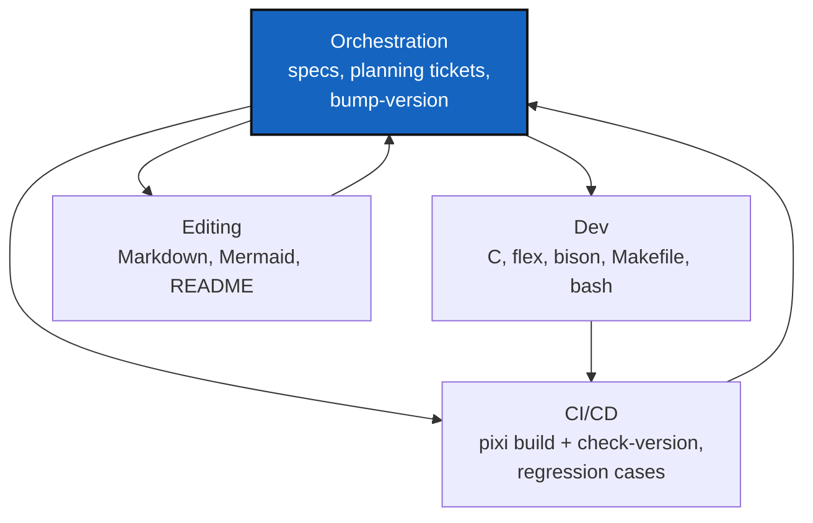

# AGENT

*Created: 2026-08-31*

*Fills in: ../../.distant/dev-sync/AGENT.md*

## Abstract — read this first

This is CaWaQS's filled-in instance of the project-agnostic multi-agent role
template — see the `AGENT.md` template in `.agent/.distant/dev-sync/` for the
full six-role roster, scope definitions, and generic handoff rules. What
follows is only what differs from, or narrows, that template for this
project: which roles this project actually exercises, and the one
project-specific handoff rule.

## Roles as used in this project

| Agent | This project's scope |
|---|---|
| **Orchestration** | `.agent/.distant/dev-sync/DevSpecs.md`, `AdditionalSpecs.md`, `audit.md`, the planning tickets under `.agent/.local/.dev/DevTickets/` (named and filed per `.agent/.distant/ticket/TICKETLIFECYCLE.md`), and `pixi run bump-version`. |
| **Dev** | C, flex and bison sources, `Makefile`s and the bash/awk install scripts, in the cawaqs root and, for a ticket that says so, in a library or in `scripts`; and `pixi run bump-build <lib>` for a library it changed. Fortran only where `libgc` already has it. |
| **CI/CD** | `pixi run build`, `pixi run check-version`, `pixi run test-versioning`, the regression cases of `gtest/testcases`, and `.gitlab-ci.yml`. |
| **Editing** | Markdown under `DevTickets/`, the README and its install tables, `CITATION.cff` wording, and Mermaid diagrams. The PDF documentation is the owner's, mounted later. |
| **Maths** | Equations and numerical schemes of the model, when a ticket changes them; otherwise not used. |
| **Scientific editing** | The citation text of the README and `CITATION.cff`; otherwise not used. |

## Project-specific handoff rule

The layers, the version rules and the frontier between `scripts`, `.dev` and
ComplexGitSync, in `AdditionalSpecs.md`, bind the Dev agent whenever it works
in the cawaqs root or in a library. A library is shared with other programs,
so a Dev agent changes its public prototypes additively only. The template's
other handoff rules (one concern per commit, up-front decomposition of
multi-role tasks) apply here unchanged.

## In a nested tree

Under a PROJECT that nests CaWaQS (HTAS), the PROJECT's orchestrator leads
and this project's agents work as its workers. Inside the cawaqs root this
project's checklist binds (build, `bump-build`, its own release); the
PROJECT's rules apply where the two meet: the commit message and the shared
release.
