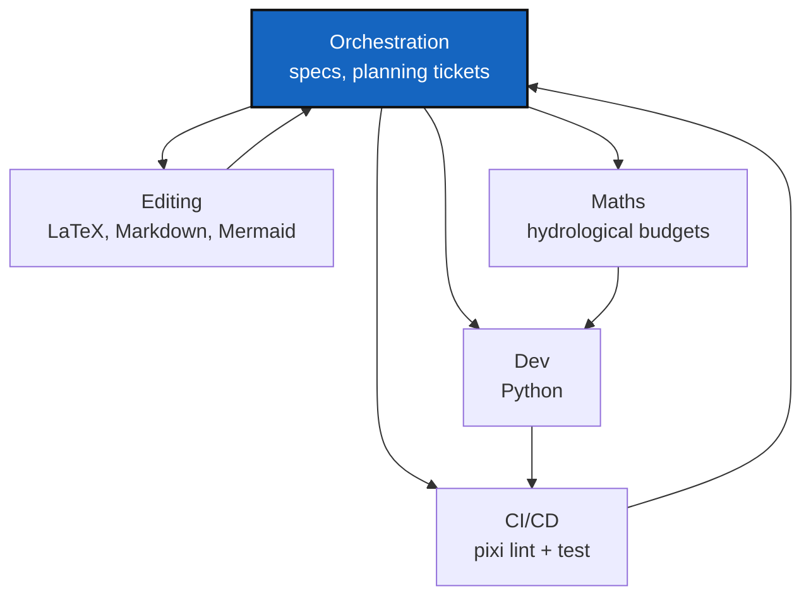

# AGENT

*Created: 2026-11-19*

*Fills in: ../../.distant/dev-sync/AGENT.md*

## Abstract — read this first

This is HydrologicalTwinAlphaSeries's filled-in instance of the
project-agnostic multi-agent role template, the `AGENT.md` in
`.agent/.distant/dev-sync/` (`flipoyo/DevSpec`), which holds the full
six-role roster, scope definitions and generic handoff rules. What follows
is only what differs from, or narrows, that template here: which roles this
project exercises, and the one project-specific handoff rule
(`AdditionalSpecs.md` binding Dev inside `src/HydrologicalTwinAlphaSeries/`).

## Roles as used in this project

| Agent | This project's scope |
|---|---|
| **Orchestration** | `AdditionalSpecs.md`, `audit.md`, and the planning tickets under `.agent/.local/.dev/DevTickets/`, named and filed per `.agent/.distant/ticket/TICKETLIFECYCLE.md`. |
| **Dev** | Python only: `src/HydrologicalTwinAlphaSeries/` and `tests/`. The template's other languages are not part of this codebase. |
| **CI/CD** | `pixi run lint` (ruff), `pixi run test` (pytest), the QGIS-free guard and the CaWaQS fixture clone in `.github/workflows/ci.yml`, and the Pixi environment. |
| **Editing** | The LaTeX user guide in `docs/hydrological_twin/`, the Markdown under `docs/` and `DevTickets/`, and Mermaid diagrams. The Slidev decks under `docs/hydrological_twin/Slidev/` are in scope. |
| **Maths** | Used: unit conversions, volumetric weighting and water budgets (`services/public/budget.py`, `vec_operator.py`, `polygon_mask.py`). A change to a formula is derived and checked by this role before Dev codes it. |
| **Scientific editing** | Used for `docs/whitepaper.md` and the bibliography of `docs/hydrological_twin/`. |

## Project-specific handoff rule

The layer and import rules of `AdditionalSpecs.md` §2–§3 bind the Dev agent
whenever it works inside `src/HydrologicalTwinAlphaSeries/`. (`audit.md` is
a different file: findings and open risks, not rules.) The template's other
handoff rules (one concern per commit, up-front decomposition of multi-role
tasks) apply unchanged.

## In a nested tree

HTAS's tree nests ComplexGitSync as a read-only tool. ComplexGitSync's own
agents and rules never act from this tree: a change ComplexGitSync needs is
written as a short ticket for ComplexGitSync's own tree, never made in the
`ComplexGitSync/` checkout here.
