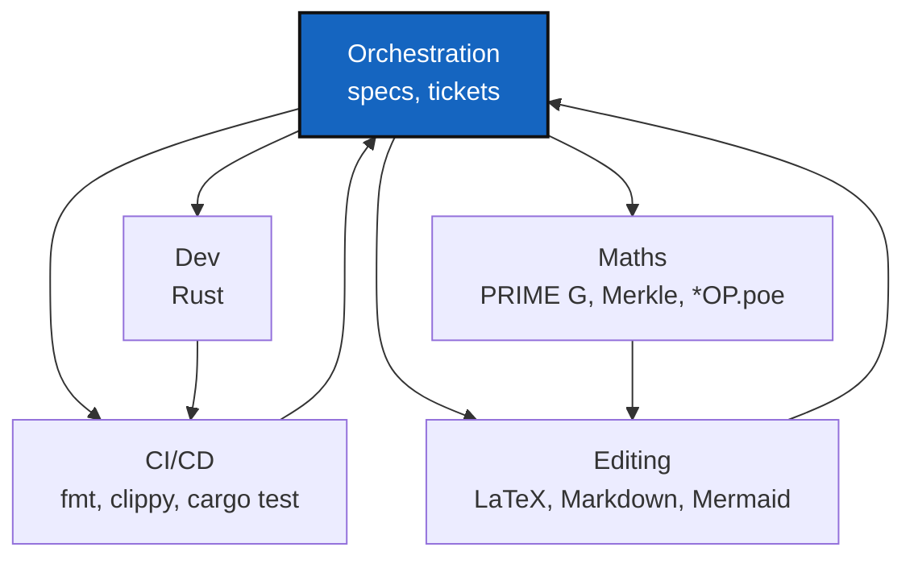

# AGENT

*Created: 2026-10-27*

*Fills in: ../../.distant/dev-sync/AGENT.md*

## Abstract — read this first

GX4G's instance of the six-role template in `.agent/.distant/dev-sync/`.
What follows is only what this project narrows: which roles it exercises,
their scope here, and the one project-specific handoff rule.

## Roles as used in this project

| Agent | GX4G's scope |
|---|---|
| **Orchestration** | `AdditionalSpecs.md`, `audit.md`, the specs (`install.cgs`, `examples/*.cgs`) and the tickets under `.agent/.local/.dev/DevTickets/`, filed per `TICKETLIFECYCLE.md`. Also the orchestrator of the pair rule. |
| **Dev** | Rust only: `src/`, `tests/`, `examples/*.rs`. The template's other languages are not part of this codebase. |
| **CI/CD** | `cargo fmt --check`, `cargo clippy`, `cargo test` through Pixi (`gx4g-dev.md`), and later `pixi.toml` (EnvConnect E0). No hosted CI yet. |
| **Editing** | `doc/` (LaTeX), `README.md`, `GX4G.md`, `tutorials/`, the tickets' Markdown, and Mermaid diagrams. No slide decks. |
| **Maths** | Used: PRIME G and its axioms, the proof vector and Σ, the four-leaf `H_project` tree and RFC 9162 proofs. It checks that the GX4G and CGS chapters and the code say the same thing. |
| **Scientific editing** | Used lightly: the theory chapters' references (RFC 9162, SemVer, the PRIME G sources). |

## Project-specific handoff rule

`AdditionalSpecs.md` §1 and §2 bind the Dev role whenever it works in
`src/`. A change to a gate rule (§3) goes through Maths and Editing in the
same change, because the book and `GX4G.md` state it too.
