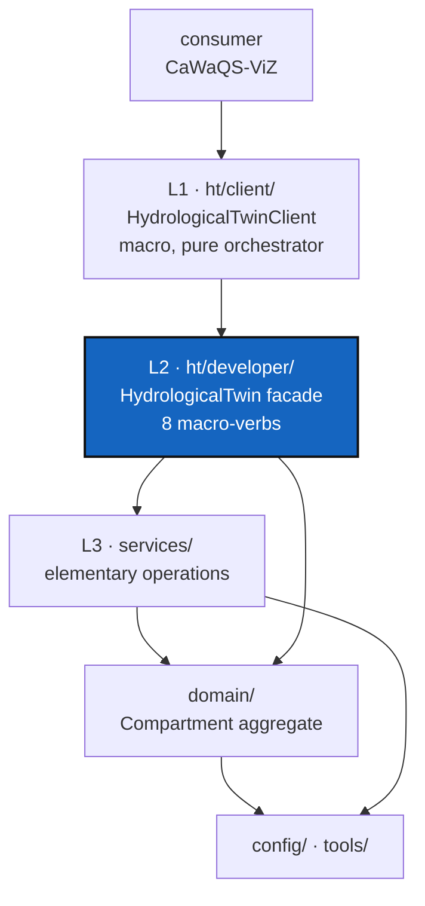

# AdditionalSpecs — HydrologicalTwinAlphaSeries-specific constraints

*Created: 2026-11-19*

## Abstract — read this first

**What this document is.** The architecture rules of the HydrologicalTwinAlphaSeries
(HTAS) backend that bind every change: what the package is, its layers, which
way imports point, and the rules that have one home. It is the project's own
specification, so no shared pattern sits above it.

**Why it exists.** The public `docs/` describe the target architecture for
contributors (`canonical_monolith.md`, `domain_model.md`) and the clean-up
still owed (`TODO.md`). An agent needs the binding part of that in one place,
with a `MUST`/`NEVER` it can be held to, and cited from `digest.md`.

**What you will find.** §1 what the package is. §2 the three layers and the
supporting packages. §3 import rules. §4 the public interface. §5 the
QGIS-free rule. §6 module shape. §7 where the details live.

**Who it is for.** The Dev agent working in `src/HydrologicalTwinAlphaSeries/`,
and the orchestrator quoting its work.

**What you need to do with it.** Read §2 and §3 before moving code between
packages. When a responsibility moves, update §2 in the same change
(`htas-dev.md` step 6). When this file and `docs/` disagree, say so in the
report and ask the owner which one is right.

---

## 1. What the package is

HTAS is the standalone scientific backend of CaWaQS-ViZ: it structures
CaWaQS simulation outputs (`.bin`, `.npy`), computes on them, and exposes a
programmatic interface. It holds no user interface, no QGIS logic and no
visualization responsibility beyond writing plots and exports to disk. It is
one monolithic package (`DevSpecs.md`, *Monolithic Canonical API*),
consumed by CaWaQS-ViZ as an external dependency.

`HydrologicalTwin` manages a structured domain of `Compartment` aggregates,
and every public operation acts on compartments, never on a mesh, an
observation or an extraction point directly (`docs/canonical_monolith.md`,
*Core Invariant*).

## 2. The layers

| Layer | Package | Responsibility |
|---|---|---|
| **L1 · client · macro** | `ht/client/` | `HydrologicalTwinClient`: one coarse method per dialog operation; `operations_client.py` chains fetch → transform → render; `api_types.py` the user-facing Result dataclasses. A pure orchestrator: no computation of its own. |
| **L2 · developer · micro** | `ht/developer/` | `HydrologicalTwin`: the facade and its eight macro-verbs; `api_types.py` the Request / Response dataclasses; `dispatch.py` and `handlers.py`, transitional internals to be folded into the micro-verbs or into L3 (`docs/TODO.md`). |
| **L3 · services · elementaries** | `services/public/`, `services/private/` | Elementary operations with no global state: I/O (`twin_io.py`), temporal aggregation, budgets, masks, vector operators, geodata assembly, rendering; `io_types.py` the leaf read DTOs. |
| domain | `domain/` | State and entities, no orchestration: `Compartment`, `Mesh`, `Observations`, `Extraction`, `TimeFrame`. |
| config | `config/` | `Config`, `ConfigGeometry`, `ConfigProject`, constants, `FactoryClass`. |
| tools | `tools/` | Generic utilities only (`spatial_utils`: CRS checks, nearest-row queries). |

## 3. Import rules

- Imports point strictly downward: L1 → L2 → L3 → domain → config / tools.
  A lower layer never imports a higher one. A type needed only for
  annotation is imported under `TYPE_CHECKING`, never at run time.
- **Tolerated for now (owner, `docs/TODO.md`):** L1 may call an L3 function
  directly (for instance the fetch of a simulation matrix). It is not
  prioritised to remove, and a change must not add new ones without saying
  so in its report.
- `domain/` never imports `services/` or `ht/`; `config/` and `tools/`
  import nothing from the other packages.

## 4. The public interface

What SemVer is measured against ([Versioning.md](../.dev/Versioning.md)):

- `from HydrologicalTwinAlphaSeries import HydrologicalTwin` (and `Config`,
  `ConfigGeometry`, `ConfigProject`), the package's `__all__`.
- The eight macro-verbs of `HydrologicalTwin`: `configure`, `load`,
  `describe`, `fetch`, `mask`, `transform`, `render`, `export`, and the
  Request / Response dataclasses they take and return.
- The methods of `HydrologicalTwinClient` and its Result dataclasses.

Everything else (`dispatch`, `handlers`, `services/private/`) is internal:
a refactor there is not a break.

## 5. QGIS-free

No module under `src/` imports `qgis`, `qgis.PyQt`, `PyQt5` or `PyQt`. CI
enforces it with a `grep` before the tests (`ci.yml`, *Enforce QGIS-free
backend*). The QGIS application layer, CaWaQS-ViZ, consumes this package;
never the other way round.

## 6. Module shape

- A module has one clear major class or one clear purpose, and every
  exported symbol is in `__all__` and documented (`DevSpecs.md`,
  *Object-Oriented Design*).
- The largest modules today are `ht/client/operations_client.py` (~1600
  lines), `ht/developer/dispatch.py` (~1270) and
  `hydrological_twin_developer.py` (~1160). No new module passes 2000 lines;
  a module that would is split, with the owner's agreement, in the change
  that would make it pass.
- Configuration and results are exchanged as dataclasses, never as raw
  dictionaries assembled by string keys across layers.

## 7. Where the details live

| Topic | File |
|---|---|
| Target architecture, layers | `docs/canonical_monolith.md` |
| Domain entities and cardinalities | `docs/domain_model.md` |
| Capabilities and examples of the API | `docs/api_capabilities.md`, `docs/api_examples.md` |
| Clean-up owed, spotted risks | `docs/TODO.md` |
| Scientific background | `docs/whitepaper.md`, `docs/hydrological_twin/` |
| Findings about this spec tree | [audit.md](audit.md) |
