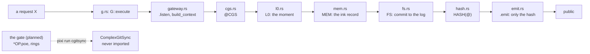

# AdditionalSpecs — GX4G's architecture and technical rules

*Created: 2026-10-27*

## Abstract — read this first

**What this document is.** GX4G's own specification for developers: what
the gate is responsible for and what it never touches, the kernel's phases
and invariants, the gate's rules, the two specs, and the Rust and
documentation conventions. It is `standalone` in the manifest: the product's
own specification, with no pattern above it.

**Why it exists.** The user-facing statement is the public
[README.md](../../../README.md), [GX4G.md](../../../GX4G.md) and the
[doc/](../../../doc/MASTER.pdf) book. They say what GX4G is. This file says
what binds a developer changing it, and points to them for the theory
instead of restating it.

**What you will find.** §1 the boundary with ComplexGitSync. §2 the
kernel, §2.1 its host side and §2.2 its proof pipeline. §3 the gate's
rules. §4 the two specs. §5 versioning. §6 Rust conventions. §7
documentation. §8 lifecycle states.

**Who it is for.** The Dev and Orchestration roles (`AGENT.md`), whenever
they work in `src/`, `tests/`, `examples/` or `doc/`.

**What you need to do with it.** Read §1 and §2 before touching `src/`.
Update this file in the change that moves a responsibility (`gx4g-dev.md`,
step 6).

---

## 1. The boundary with ComplexGitSync

GX4G is the gate; ComplexGitSync is the tool behind it. The line between
them:

| GX4G | ComplexGitSync |
|---|---|
| Calls `pixi run cgitsync` in the nested clone, as any user would, and reads what it records | Never imported, never patched, given no access-control code |
| Decides what a request reaches: `*OP.poe`, Σ, the ring | Knows nothing of rings |
| Holds the `.omniscience` register: mounts it, writes to it, answers for it | Produces records and findings; adds no write path of its own (its ProviderMigration) |
| Calls the Git hosts' APIs (`gh`, `glab`, `tea`, REST), for host rights | Calls none; Git itself stays its own |
| Registers `H_project` as cgitsync hands it | Computes `H_project` and every `.root` under it |

**GX4G never computes a Merkle root or a `node` hash.** `H_project`, the
four roots under it and the proofs are `.cgitsync`'s. GX4G receives and
relays them (EnvConnect E4 adds a test that greps for such a function).

**X never crosses the frontier.** Only the memory knows `X.root`. GX4G
handles its hash at most, and the `.omniscience` record holds no X.

## 2. The kernel

One path makes a proof, and only `G::execute` runs it. Eight phases in one
fixed order, one module owning each, and one type passing from each to the next
(tutorial 02; the rules of each step are in §2.2):

| Phase | Module | Takes | Returns |
|---|---|---|---|
| `.listen`, `build_context` | `gateway.rs` | the request's CLIENT and SERVER | `ExecutionContext`, borrowed |
| `@CGS` | `cgs.rs` | `ExecutionContext` | `CgsOutput`: STATE and SPACE |
| L0 | `l0.rs` | `CgsOutput`, an `AnchorSource` | `AnchoredComputo`, stamped with a `Moment` |
| MEM | `mem.rs` | `AnchoredComputo` | `InkRecord`: owned, canonical bytes |
| FS | `fs.rs` | `InkRecord`, a `Store` | `Written`: committed, read back, with its place in the log |
| `HASH(@)` | `hash.rs` | `Written` | `ExecutionHash` |
| `.emit` | `emit.rs` | `ExecutionHash` | `GatewayOutput`, the only public value |

Each step takes only what the one before returned, so the order is the types':
no phase can be skipped, reordered or run twice, and a failure stops every later
phase. `g.rs` holds `G`, which runs them. `version.rs` holds the two version
numbers (§5). `lib.rs` re-exports the public items and holds no logic.

**Invariants.**

1. **The order is fixed**: `.listen → build_context → @CGS → L0 → MEM → FS →
   HASH(@) → .emit`. Time precedes memory, and the proof is derived last.
2. **Only a hash leaves, and only the gate makes one.** The phase functions are
   `pub(crate)`, every module is private, and every type that passes between
   the phases (`State`, `Space`, `CgsOutput`, `ExecutionContext`, `Gateway`,
   `AnchoredComputo`, `Anchor`, `InkRecord`, `Written`) is crate-private: a
   caller cannot even name one. `ExecutionHash` has a private field, and the one
   function that fills it takes a `Written`, which exists only for a record that
   was committed, read back and checked. `GatewayOutput` has a private field and
   a crate-private constructor. An invariant the compiler can hold is held by a
   type, not by a runtime check, and `tests/ui/` pins each one with the
   compiler's own message.
3. **One responsibility per module**, and modules communicate only through
   immutable values: borrowed, or moved, and never mutated after construction.
   MEM computes nothing and writes nothing; FS anchors nothing and emits nothing;
   L0 owns no STATE and persists nothing; the Gateway owns communication only.
4. **`hash.rs` is the only module that hashes.** Every preimage starts with a
   domain string and is length-delimited (§2.2). A type implementing
   `CanonicalBytes` names itself with `TYPE_LABEL`, which has no default. A
   change to what is hashed, or how, is a new version of its domain, with a
   golden-hash test whose value is recomputed independently of the Rust code
   (`tests/spec/spec.py`) and a migration note. A released hash never changes meaning.
5. **Deterministic given its inputs.** No *ambient* clock, randomness,
   environment or iteration order enters a hash. The anchor is an input: it
   enters as a supplied value, and `SystemClock` is the only place the crate
   reads the wall clock. The same content, the same anchor and the same
   sequence give the same `HASH(@)` on every machine.
6. **The public surface is a list.** `src/lib.rs` is the only place anything
   is exported, and `tests/public_surface_tests.rs` fails when the list
   changes, or when a type that passes between the phases appears in it.
7. **File I/O is in one place.** Only `FileStore`, in `fs/file.rs`, touches the
   file system, with `std` and no dependency. The crate opens no socket.

### 2.1 The host side, offline

`G` is the one public API over the Graph `G{NAME-G, NODE-G, EDGE-G, OP*-G}`
(BeforeCgitsyncMerge, D2): each constituent is a Graph, and `EDGE-G` is an
interface that declares nothing but the API through which `G` reaches the
outside. That interface is `GitProvider`. `NAME`, `NODE` and `OP*` join `G`
with EnvConnect E2. Until then `G<Edge, L0, Mem>` carries its EDGE, its L0 (an
`AnchorSource`) and its MEM (a `Store`), and runs the proof pipeline (§2.2)
through `G::execute`, so `Gateway` is no longer a public entry (TypedPipeline,
D07). A `G` that only makes proofs uses `Offline`, an EDGE that reaches no host:
it is the one provider that exists outside tests, and it refuses every
repository with `GitError::NoHost`.

| Module | Holds | Reached by a caller as |
|---|---|---|
| `g.rs` | `G<Edge, L0, Mem>`: `execute`, `verify`, `verify_log`, `repo`, `rights`, `access` | `G`, the one entry |
| `provider.rs` | `GitProvider` (sealed trait; `host()` is an `Option`), `Offline`, `GitError` | the trait as a bound, the error as a result |
| `repo.rs` | `GitRepo`: private fields, crate-private `open` | only through `G::repo` |
| `identity.rs` | `Host`, `Owner`, `RepoName`, `IdentError`, the parser | values read from a `GitRepo`, never built |
| `ring.rs` | `Ring` (Σ), `Access` (None < Read < Write < Push) | values |
| `secret.rs` | `Secret` | wraps a token, never printed |
| `fake.rs` | `FakeProvider`, a scripted host | tests only: `cfg(test)`, or the `testing` feature |

Rules:

- **No network code in this crate** until EnvConnect E6. A real provider is a
  type in this crate that implements `GitProvider` and passes the contract
  suite (`tests/provider_contract.rs`) against a local mock server first.
  No test ever calls a real host.
- **`GitProvider` is sealed.** Only this crate adds a host.
- **Rights first (owner, D4).** The trait asks for a right and nothing else.
  Reading and writing content are designed, each behind its own ring, and are
  added by the milestone that builds them, with their own contract cases.
- **A host can only narrow a ring.** `G::access` is
  `min(ring.ceiling(), host right)`: `Public` reaches nothing, `User` reads,
  `Dev` writes, `Opx` pushes. A host that cannot be asked gives no access,
  never the ceiling.
- **An answer is information, never a permit.** The host is asked every time.
  Nothing caches.
- **A repository identifier is parsed, never trusted.** It is
  `<host>:<owner>/<name>`: an unknown host, a second `/`, anything outside
  ASCII letters, digits, `-`, `_` and `.`, a part over 100 bytes, `.` or
  `..`, an owner starting with `.` or `-`, and a `.git` suffix in any case
  are refused. The host's address comes from the provider's type. GitLab
  sub-groups are not supported yet.
- **A rate limit is not a refusal** (`GitError::RateLimited`), and neither is
  retried by `G`.
- **No error, `Debug` or `Display` carries a token or the input.** A token is
  a `Secret`: it prints `<redacted>`, is not `Clone`, and is not a field of a
  `GitRepo`. It is not wiped on drop, because that needs `unsafe` or a new
  dependency.

### 2.2 The proof pipeline

**Five hashes, five domain strings, one module.** Every part of a preimage is an
8-byte big-endian length, then the bytes. The domain string is written first and
is not itself length-delimited.

| Hash | Domain | Preimage |
|---|---|---|
| `CONTENT_HASH` | `GX4G\0CONTENT\0V1` | `STATE`, its type label, its bytes, then `SPACE`, its type label, its bytes |
| record hash | `GX4G\0RECORD\0V1` | the bytes of the ink record |
| log entry hash | `GX4G\0ENTRY\0V1` | the bytes of the log entry |
| `HASH(@)` | `GX4G\0PROOF\0V3` | the moment (12 bytes), the sequence (8), `CONTENT_HASH`, the record hash |

**The bytes, exactly.** A *moment* is twelve bytes: the seconds as a `u64`, then
the nanoseconds as a `u32`, each big-endian. STATE is DELTA, the SERVER's NODE,
and SPACE is NABLA, the CLIENT's EDGE. An operand's *type label* is its
`TYPE_LABEL` (`UTF8` for text, `BYTES` for bytes) and its bytes are its
`canonical_bytes` (the UTF-8 of a `String`). The *record hash* covers the whole
encoded record as one length-delimited part. A *log entry* is five
length-delimited parts: the domain string `GX4G\0LOG\0V1`, the sequence as eight
bytes, the previous entry's hash (32 bytes, zeros for the first entry), the
moment, and the record hash. Files are named `records/<64 hex digits>.rec` and
`ledger/<20 digits>.entry`. `tests/spec/spec.py` implements exactly this and
nothing else.

`V3` supersedes the `GX4G\0FS\0V2` hash of 0.2.0, which covered STATE and SPACE
alone. `CONTENT_HASH` never crosses the gate and does not depend on the anchor:
the same content has the same value, and distinct anchored executions have
distinct `HASH(@)` (TypedPipeline, D04, answered 2026-10-28).

**The anchor `@` is the moment and the sequence.** L0 stamps a `Moment` (a UTC
instant: seconds and nanoseconds) before MEM inks anything, from an injected,
sealed `AnchorSource`: `SystemClock` (live) or `FixedAnchor` (fixtures, and
replay with the recorded anchor). The log numbers the record when FS commits it.
Together they are unique per execution. A record that does not commit leaves no
anchor and no entry. The moment is a claim of the clock; the sequence is the
log's order, and it is the sequence that orders executions.

**The ink record** is eight length-delimited parts and nothing after them: the
domain string `GX4G\0INK\0V1`, the moment, the role `STATE`, its label, its
bytes, the role `SPACE`, its label, its bytes. It owns its bytes. Reading one
back refuses a truncation, trailing bytes, a wrong domain, swapped roles, a
moment out of range, and a length that claims more than remains, before
copying anything. A record over 64 MiB is refused when it is built and when it
is read.

**The store** (`Store`, sealed) holds two things. *Records*, content-addressed:
the record whose bytes hash to `h` is stored under `h`, and an existing record
is never replaced, so damage to it is found by verification and not repaired by
a rerun. *A log* of immutable, numbered entries: entry `n` carries `n`, the hash
of entry `n - 1` (zeros for the first), the moment, and the record hash. A
record is **committed** when its entry is published.

- **Atomic.** `FileStore` writes to a temporary name in its own directory,
  flushes it with `fsync`, then publishes it: a record by hard link (exclusive,
  so a name is never replaced), an entry by hard link too. A reader sees a whole
  file or none, and a crash leaves at worst a temporary file, which nothing
  reads. On Unix the directory is flushed as well; Windows has no way to, and
  the file was flushed.
- **Exclusive.** Publishing an entry fails, changing nothing, when its number is
  taken. A commit then starts again from the new tip, at most 64 times, then
  gives up with `StoreError::Busy`. Two writers never share a sequence number.
- **Read back.** `materialize` reads the record and the entry back after
  writing them and refuses (`Corruption::ReadBackMismatch`) unless they are what
  it wrote. `HASH(@)` is then derived from what is stored, not from what was
  meant, so a store that claims a write it did not make gives no proof.
- **Verified.** `G::verify_log` walks the log from the first entry: every entry
  is there, numbers itself, names the one before it, and commits a record that
  is stored, hashes to what the entry names, decodes, and agrees with the entry
  on the moment. The first failure is named by position (`Corruption`) and
  nothing is repaired. `G::verify` recomputes the proof of each entry in turn and
  returns the position of the one that matches, having checked the log up to it.
- **Two backends, both in this crate**: `FileStore` and `MemoryStore`. The trait
  is sealed, because a backend that could be added from outside could claim a
  write that did not happen and the proof would still be emitted. Its
  primitives are sealed too: each takes a `Permit` that only this crate can
  make, so even through a generic `S: Store` bound an outside caller cannot
  write a record or publish an entry by hand, and so cannot make `verify_log`
  confirm an execution the gate never ran.
- **No path and no byte in an error.** `StoreError` keeps the kind of an I/O
  failure, never a path, and `Corruption` names a position, never content.
  `MemoryStore`'s `Debug` shows counts, because a record holds the execution's
  private operands.

## 3. The gate's rules

The theory is [GX4G.md](../../../GX4G.md) and the GX4G chapter of the
book. What binds the code, most of it planned in EnvConnect:

- **`*OP.poe = {OP.poe, NAME.poe, NODE.poe, 0}`.** A coordinate is `0`,
  true, once `.env` records it; `1` is open. The fourth is the constant `0`:
  the `Poe` type has three fields and no fourth, so it cannot be set (E2).
- **Σ picks the ring**: 3 PUBLIC (the static `.cgs` report, no cgitsync
  call), 2 USER (the `.gts`), 1 DEV (`.memory`), 0 OPX (`.cgitsync`). **Only
  Σ = 0 may change a tree.** Each ring makes exactly its cgitsync call and
  no other (E3).
- **Nothing is bypassed.** A `cgitsync` run without the gate is anonymous,
  and recorded in `.env` when it writes a snapshot. GX4G reads it there; it
  never prevents it.
- **The gate meets the world only at `.omniscience`**, and registers
  exactly `(time, loc, H_project)`. `time` and `loc` are claims and change
  no hash.
- **The id** is `cgitsync-<SemVer>.<Trunk>-<NAME>`, parsed with the one
  pattern in the Architecture chapter (§ *The GX4G id*), never split on one
  character. A pre-release SemVer is accepted; build metadata (`+…`) is
  refused.
- **No credential is stored or printed.** A token used for a host's API
  never appears in output, logs, records or fixtures (E6).

## 4. The two specs

| Spec | For | Rule that shaped it |
|---|---|---|
| `install.cgs`, at the root | USER, `cgitsync initialise` | ComplexGitSync is a leaf, `nested_config = "disabled"`; `"auto"` would mount its documentation. It mounts no private repository |
| `examples/gx4g4dev.cgs` | DEV, `cgitsync bootstrap` | Lives in `examples/`, because `"auto"` refuses a repository root holding two `.cgs` files. Declares `.omniscience` beside `.cgitsync`, private and writable. It is the only `.cgs` in `examples/`: a second one for the agentic tree alone was dropped (owner, 2026-10-28), and its `.agent/` entries are mounted by hand until ComplexGitSync's NestedAgentMaster lets the whole file open |

Every mount under `.agent/` is listed in [AgenticManifest.md](AgenticManifest.md),
in the same change that adds it to a spec.

## 5. Versioning

SemVer in `Cargo.toml`, read as `gx4g::VERSION`; the build counter
`gx4g::BUILD` in `src/version.rs`, for DEV only. Neither ever enters a
hash. Where each is mirrored and how it moves is
[.dev/Versioning.md](../.dev/Versioning.md).

## 6. Rust conventions

- **Rust stable, edition 2024.** One dependency, `sha2`. Dev-dependencies
  `proptest` and `trybuild`, and nothing else without the owner's word.
- **The toolchain comes from Pixi**, never `rustup` or a system install,
  in docs and in CI (`gx4g-dev.md`, *Commands*).
- **`#![forbid(unsafe_code)]` and `#![deny(missing_docs)]`** are in `lib.rs`,
  and `tests/public_surface_tests.rs` checks both are still there.
- **Lints are in `Cargo.toml`**, not remembered: `clippy::pedantic`, and
  `unwrap_used` and `expect_used` as warnings, with `clippy.toml` allowing
  `expect` inside tests. `cargo clippy --all-targets --all-features -- -D
  warnings` is clean, and so is the same command without the feature.
- **No panic path from input.** A failure is a typed error. `src/` holds no
  `unwrap` and no `expect`.
- DevSpecs' object-oriented rules read, in Rust: a domain concept is a
  `struct` or `enum` owning its validation and its lifecycle, side effects
  live in its methods, and the public surface is what `lib.rs` re-exports.
  Every public item is documented, and a public function that can fail has an
  `# Errors` section.
- Errors are typed `enum`s (`CgsError`, `ContextError`, `ExecutionError`,
  `IdentError`, `GitError`), never a string.
- **Tests, by layer.** Unit tests are `#[cfg(test)] mod tests` at the foot of
  the `src/*.rs` they test, and see private items; a long one lives beside its
  module (`src/fs/tests.rs`, `src/g/tests.rs`). The proof tests that cannot be
  written from outside, such as a phase taking only the type before it, are
  unit tests, and the signatures hold the order. `tests/*.rs` are
  integration tests: they use the public API only, as an outside crate would.
  `tests/ui/*.rs` (and `tests/ui_testing/`, which needs the `testing`
  feature) are `trybuild` compile-fail cases, each with a `.stderr` snapshot
  of the compiler's message: they replace the four compile-fail doctests the
  kernel had, because a doctest can only reach the public API and cannot say why
  it failed. A snapshot is read before it is accepted: it must fail for the
  reason its file says. `proptest` covers the hash framing, and
  `tests/provider_contract.rs` is one generic suite run once per provider.
  No test reaches the network. A test that writes uses a directory of its own
  under the system's temporary directory, removed when the test ends, and
  never the working directory or a fixed path.
- **A new test is shown to be able to fail.** A property or surface test is
  checked once against a deliberate bug.
- **Supply chain.** `Cargo.lock` is committed. `deny.toml` allows only
  Apache-2.0 and MIT, crates.io, no wildcard version, and fails on a yanked
  crate or a known advisory. `cargo deny` and `cargo audit` run before a
  release.

## 7. Documentation

- **The book is `doc/`**, LaTeX, inside the gx4g repository: `MASTER.tex`
  and one `c_<chapter>.tex` per chapter, the built PDFs tracked beside them.
  `doc/Setup/Shortcuts.tex` holds the product macros: `\gxversion`,
  `\cgsversion`, and `\planned`, which marks every statement of design not
  yet built.
- **The README is the user's front page**: what GX4G is, the two ways in,
  the use cases with their tutorials, and *What works today*, which says
  for each piece whether it is built or designed.
- **`GX4G.md` is the specification on one page**, a summary of the book.
  When the two disagree, the book is right.
- **Tutorials** are numbered `NN_name.md` in `tutorials/`, listed in its
  `README.md` and in the README's use-case table.
- **The Rust guide has two forms** and explains without stating a rule:
  `.dev/RustGuide.md` (ten Mermaid diagrams, private) and
  `doc/Text/rust_guide.tex` (the seven that explain the public architecture,
  redrawn in TikZ). The three that show the threat model stay private until
  the owner says otherwise. A change to what a diagram shows changes both.
- When ComplexGitSync's version cited in the docs (`\cgsversion`, the
  README, `GX4G.md`) changes, every statement about what it does is checked
  in the same change.

## 8. Lifecycle states

The kernel has no stateful managed object: each phase consumes immutable
values and returns new ones. The gate's states (a request's ring, an OP's
proof vector) are designed in EnvConnect §3 and §4, and their transitions
are written here when E2 lands.
