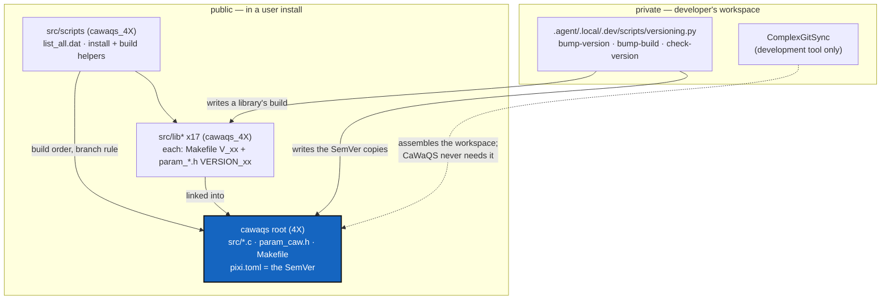

# AdditionalSpecs — CaWaQS: the product, its layers and its version rules

*Created: 2026-08-31*

*Rewritten for CaWaQS: 2026-11-25 (BuildSemVerAgenticC §3.4)*

## Abstract — read this first

**What this document is.** The project's own specification: what CaWaQS is,
the 17 libraries it is built on and the order they build in, the frontier
between `scripts`, the private `.dev` and ComplexGitSync, how the code is
shaped, and the rules for the version numbers. It has no pattern above it.

**Why it exists.** The Operating Space was seeded with ComplexGitSync's
Python specification. None of it applies to a C code base, and the version
rules of CaWaQS (one SemVer, a build per library) are written nowhere else.

**What you will find.** §1 the product. §2 the layers. §3 the frontier.
§4 the install. §5 the version rules. §6 the code: interface, module shape,
dialect, regression. §7 what never changes.

**Who it is for.** Anyone changing C code, a `Makefile`, an install script or
a version number.

**What you need to do with it.** Read §5 before touching any version, and §2
before adding an `#include` across libraries.

---

## 1. What CaWaQS is

CaWaQS (CAtchment WAter Quality Simulator) is a physically based coupled
surface–subsurface model: it simulates water, matter and energy fluxes and
flow dynamics in every compartment of a hydrosystem (sub-surface, hydraulic
network, vadose zone, aquifer system, stream–aquifer exchanges). It is a
single executable, `src/cawaqs<SemVer>`, linked from the code of the cawaqs
root and the 17 static libraries below.

- Language: C, with `flex` and `bison` (`src/lexical.l`, `src/input.y`) and
  one Fortran file in `libgc`. The toolchain is pinned by `pixi.toml`
  (`gcc` and `gfortran` 13, `make`, `bison`, `flex`).
- Product tree: `src/` (sources, `Makefile`, `param_caw.h`), `docs/`,
  `pixi.toml`, `CITATION.cff`, `install.sh`.

## 2. The layers

The 17 libraries are built in the order of
`src/scripts/list_all.dat` (duplicates ignored):

`print`, `ts`, `pc`, `io`, `gc`, `chronos`, `rsv`, `spa`, `nsat`, `fp`,
`mesh`, `aq`, `ttc`, `hyd`, `wet`, `seb`, `ap`.

Each is a repository at `src/lib<code>`, with its sources in `src/`, a
`Makefile` and one `param_*.h` header.

- A library may include the headers of the libraries that build before it,
  never of one that builds after it.
- `libprint` (logging, `LP_*`) and `libts` (time series) are the base;
  cawaqs itself is the top and is never included by a library.
- The libraries are shared with other programs of the ecosystem. A change to
  a library's public prototype breaks every program that calls it, so a
  library's interface changes additively (see `LP_log_file_header` in §5).
- CaWaQS is a dependency of HTAS (the Hydrological Twin AlphaSeries), never
  the reverse: no file of CaWaQS includes, calls or names HTAS.
- Branches: in a development workspace the cawaqs root is on the bare branch
  `<b>` (`4X`) and every other repository that is not private (the 17
  libraries and `scripts`) is on `<project>_<b>` (`cawaqs_4X`), falling back
  to `main` when that branch does not exist.

## 3. The frontier: `scripts`, `.dev`, ComplexGitSync

| Layer | Language, visibility | Owns | Never does |
|---|---|---|---|
| **`scripts`** (`src/scripts`) | bash and awk, public, in the user install | **Inputs:** `list_all.dat`, the code → `V_xx` mapping. **Fetch:** clone and check out by the branch rule of §2. **Build:** the one build (`build_tree.sh` from `scripts` 1.0.0; until then, the functions copied in `make_Cawaqs_fromCGS.sh`) | Write a committed version |
| **cawaqs `.dev`** (`.agent/.local/.dev/scripts/versioning.py`) | Python, private, developer workspace only | **What is CaWaQS's own:** where the SemVer is copied, how a library's build is bumped. Reads the library list from `src/` and has no copy of it | Walk the tree, or decide which repositories to bump |
| **ComplexGitSync** | Python, public, generic; a development tool of the Operating Space only | **The developer's workspace:** `cgitsync bootstrap`, `branch`, `status`, `version diagnose / bump` | Know where CaWaQS copies its version, build CaWaQS, or be needed by CaWaQS or `scripts` |

The arrow goes one way: the Operating Space uses ComplexGitSync, and
ComplexGitSync knows nothing of CaWaQS.

## 4. Installing

- **`pixi run install`** belongs to the Operating Space (owner, 2026-11-25),
  in its rough form (`.config/cawaqs.cgs`) and its dev form (`-s -dev-4X`).
  The README promotes it first. `pixi run build` recompiles with
  `src/make_Cawaqs_fromCGS.sh`, with no git operation.
- **The manual install**, for minimalist developers, with no agentic mount
  and no ComplexGitSync: `src/make_Cawaqs.sh` and
  `src/make_Cawaqs_from_branches.sh`. It needs git, bash, gcc and make. It
  stays supported.
- `src/make_Cawaqs.sh` is destructive (it clones and deletes libraries); the
  CI uses it until it moves to the manual install with `-p`/`-b` (cawaqs
  4.3.0, with `scripts` 1.0.0).

## 5. The version rules

- **One SemVer for CaWaQS.** `pixi.toml` `[workspace] version` is the
  reference. It is copied into `src/param_caw.h` (`NVERSION_CAW`, a string),
  `src/Makefile` (`V_CAW`, **unquoted**: make would take the quotes into the
  binary's name and relink on every build), `CITATION.cff` (`version`,
  `date-released`) and the README (the `Current_version` badge and the
  "SemVer in `pixi.toml`" sentence). Nothing edits one by hand:
  `pixi run bump-version` writes all of them or none.
- **`NVERSION_CAW` is a string, printed with `%s`, never `%f`** or `%4.2f`.
- **A library keeps a build, `MAJOR.XX`**, with one source: its own
  `src/Makefile` `V_xx` and the `#define VERSION_xx` of its `param_*.h`. It is
  printed with `%4.2f`. cawaqs's `src/Makefile` repeats every `V_xx` so that a
  plain `make` links; the build rewrites the other libraries' copies in the
  `Makefile_tmp` it compiles, so those copies may lag. `pixi run
  bump-build <lib>` moves the library's two fields and cawaqs's copy.
- **`LP_log_file_header` and `LP_file_header` take either** a `double` (a
  build) or a string (a SemVer), under one name, since `libprint` 1.25
  (`_Generic`, additive: a program compiled against the old prototype still
  links).
- **Regular SemVer applies by default.** An exception exists only when the
  owner states it for a named release, and it covers only that release.
  Stated so far: cawaqs 4.2.0 and 4.3.0 are minor despite their breaks,
  because 4.x had never been used (BuildSemVerAgenticC, D15).
- **A branch that predates this** (`s-confined`) merges by keeping 4X's
  version line, and bumping by what the merge brings.

## 6. The code

- **Interface.** A simulation is driven by `.COMM` command files, parsed by
  `src/lexical.l` and `src/input.y`, and writes its log and output files from
  `manage_output.c` and `manage_link_output.c`. Every log opens with
  `# CaWaQS <SemVer> -- Log file`. A change to the `.COMM` grammar or to an
  output file is a change to the user's interface and is stated in the
  release notes.
- **Module shape.** One file per concern, named by prefix: `manage_*.c`
  (reading, linking and output of one kind of data), `<LIB>_*_coupled.c`
  (the coupling of cawaqs with a library: `FP_`, `HYD_`, `AQ_`, `NSAT_`,
  `AP_`), `global_CAWAQS.c`, `main_cawaqs.c`. There is no size ceiling for
  now (owner, D5).
- **C dialect.** The code is documented as it is: no `-std` and no `-Wall`
  are set in the `Makefile`s. A trial of `-std=gnu99 -Wall`, adopted only if
  everything builds with no source edit, is recorded in
  [audit.md](audit.md). `_Generic` (C11) is accepted by gcc in every mode.
- **Regression.** `gitlab:cawaqs/gtest/testcases` holds the cases. The CI
  runs two of them, `HYDRO_COUPLED.COMM` and `HYDRO_REPSUR.COMM`, with
  `src/cawaqs<SemVer> <case>.COMM log.txt`, from the `testcases` directory.
- **Documents.** The PDF documentation is mounted by the owner in the
  development space later; until then `bump-version` leaves the
  `Documentation` badge and the PDF alone (D7).

## 7. What never changes

- No `main` branch of a library or of `scripts` moves for a ticket of this
  project: all development lands on `cawaqs_4X`, and `main` receives it when
  `cawaqs_4X` is merged, before any other branch.
- A shared library holds no `pixi.toml` and no agentic file.
- `scripts` writes no committed version.
- CaWaQS builds and installs with no ComplexGitSync.
