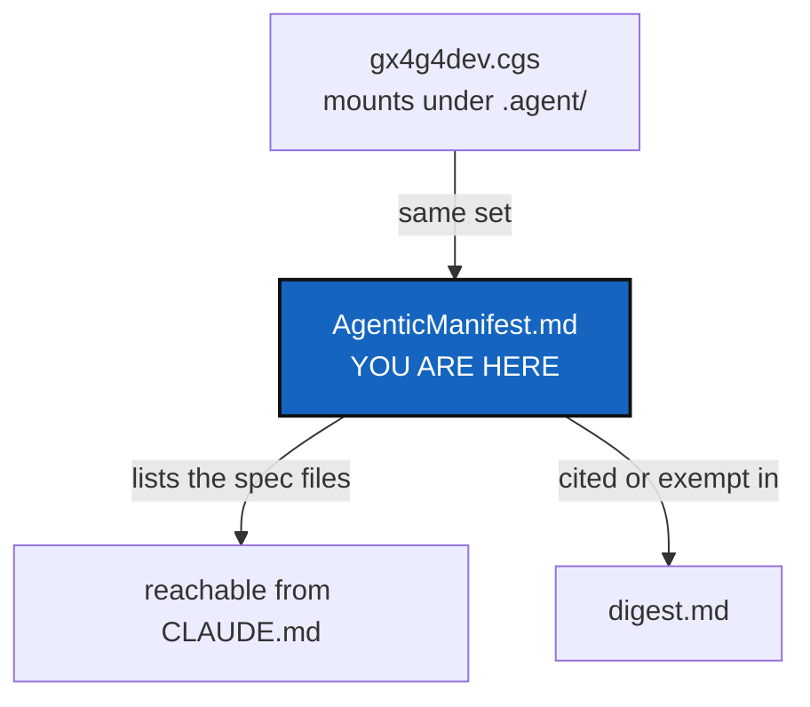

# Agentic manifest — every mount under `.agent/`, and which of its files are specs

*Created: 2026-10-27*

*Fills in: ../../.distant/dev-sync/SpecTree.md*

## Abstract — read this first

**What this document is.** The one list of the repositories mounted under
`.agent/` by `examples/gx4g4dev.cgs`, and of the Markdown files in them that the spec
tree must reach.

**Why it exists.** A list kept in two places drifts. This is the one place,
and a mount added to a spec is added here in the same change.

**Who it is for.** An agent looking for where a kind of rule lives.

**What you need to do with it.** Read the *role* column to find the mount.
GX4G has no script checking this file yet (`audit.md`).

---

## Mounts

`.agent/` is a plain directory, never a repository, and is ignored by the
gx4g repository. Every repository below is declared directly in the spec.

| mount | repository | side | branch | role |
|---|---|---|---|---|
| `.agent/.distant/ticket` | `github:flipoyo/.ticketing` | distant | `main` | How a ticket is named, ranked, moved and closed |
| `.agent/.distant/dev-sync` | `github:flipoyo/DevSpec` | distant | `main` | The development philosophy, agent conduct, versioning, the spec-tree rule, the role template |
| `.agent/.distant/documentation` | `github:flipoyo/DocSpec` | distant | `main` | How a Markdown document is written |
| `.agent/.local/.dev` | `github:flipoyo/.dev` | local | `gx4g` | How GX4G's work gets done: the checklist, versioning, `DevTickets/` |
| `.agent/.local/.localSpec` | `github:flipoyo/.localSpec` | local | `gx4g` | The deeper specs: architecture, roles, audit, digest, this manifest |
| `.agent/.local/.claude` | `github:flipoyo/.claude` | local | `gx4g` | What an agent is handed at session start |

## Spec files

| file | mount | level | digest |
|---|---|---|---|
| [CLAUDE.md](../.claude/CLAUDE.md) | `.claude` | fills in [SpecTree.md](../../.distant/dev-sync/SpecTree.md) | cited |
| [AGENT.md](../.claude/AGENT.md) | `.claude` | standalone | exempt: states the reading order only |
| [AdditionalSpecs.md](AdditionalSpecs.md) | `.localSpec` | standalone | cited |
| [audit.md](audit.md) | `.localSpec` | standalone | exempt: findings and open risks, not rules |
| [AGENT.md](AGENT.md) | `.localSpec` | fills in [AGENT.md](../../.distant/dev-sync/AGENT.md) | exempt: the roster; the handoff rules are cited from the pattern |
| [digest.md](digest.md) | `.localSpec` | standalone | exempt: the digest itself |
| [AgenticManifest.md](AgenticManifest.md) | `.localSpec` | fills in [SpecTree.md](../../.distant/dev-sync/SpecTree.md) | cited |
| [README.md](../.dev/README.md) | `.dev` | standalone | exempt: a pointer to the mount's documents |
| [gx4g-dev.md](../.dev/gx4g-dev.md) | `.dev` | fills in [AgentConduct.md](../../.distant/dev-sync/AgentConduct.md) | cited |
| [Versioning.md](../.dev/Versioning.md) | `.dev` | fills in [Versioning.md](../../.distant/dev-sync/Versioning.md) | cited |
| [RustGuide.md](../.dev/RustGuide.md) | `.dev` | standalone | exempt: explains the architecture and the Rust ideas for a reader who does not write Rust; states no rule |
| [README.md](../.dev/DevTickets/README.md) | `.dev` | fills in [TICKETLIFECYCLE.md](../../.distant/ticket/TICKETLIFECYCLE.md) | exempt: where tickets sit and GX4G's branches |
| [AgentConduct.md](../../.distant/dev-sync/AgentConduct.md) | `dev-sync` | pattern | cited |
| [DevSpecs.md](../../.distant/dev-sync/DevSpecs.md) | `dev-sync` | pattern | cited |
| [Versioning.md](../../.distant/dev-sync/Versioning.md) | `dev-sync` | pattern | cited |
| [SpecTree.md](../../.distant/dev-sync/SpecTree.md) | `dev-sync` | pattern | cited |
| [AGENT.md](../../.distant/dev-sync/AGENT.md) | `dev-sync` | pattern | cited |
| [AgentDataContract.md](../../.distant/dev-sync/AgentDataContract.md) | `dev-sync` | pattern | exempt: the owner's intent; the binding half is AgentConduct.md §3 |
| [DOCSTYLE.md](../../.distant/documentation/DOCSTYLE.md) | `documentation` | pattern | cited |
| [TICKETLIFECYCLE.md](../../.distant/ticket/TICKETLIFECYCLE.md) | `ticket` | pattern | cited |
