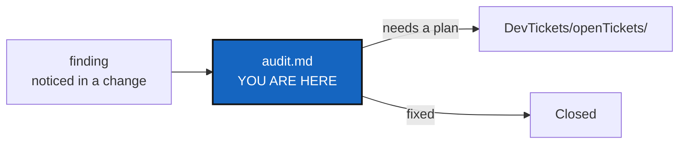

# Audit — findings and open risks in HydrologicalTwinAlphaSeries's spec tree

*Created: 2026-11-19*

## Abstract — read this first

**What this document is.** Findings that are not rules: places where the
code, the public docs and these specs disagree, and open risks, each with
where it is tracked. Clean-up of the code itself is tracked in the public
`docs/TODO.md`; this file does not repeat it.

**Why it exists.** A finding noticed in passing and left in a report is
lost. Here it waits for a ticket or a fix.

**What you will find.** One table of open findings, then the findings
closed, with the change that closed them.

**Who it is for.** The orchestrator, when it ranks tickets or quotes a
change.

**What you need to do with it.** Add a row when you find a disagreement you
do not fix in the same change; move it to *Closed* in the change that fixes
it.

---

## Open findings (2026-11-19, seeding of the HT-BETA spec tree; 11–14 added 2026-11-20 by DocsOnTheFly M1)

| # | Finding | Where | Tracked by |
|---|---|---|---|
| 3 | `docs/TODO.md` still holds an unresolved merge conflict (`<<<<<<< HEAD` … `>>>>>>> 388d82e`) | `docs/TODO.md:71-148` | none yet |
| 5 | An L3 module imports from L2: `services/private/raw_data_export.py:20` imports `ht.developer.api_types` (indented, to check it is under `TYPE_CHECKING`) | `services/private/raw_data_export.py` | none yet |
| 6 | The README names no agent: there is no *LLM assistance* section, which AgentConduct §3 expects when an agent contributes | `README.md` | owner's decision |
| 7 | No `check-spectree` task: the agreement of `AgenticManifest.md` with `.config/htas-dev-beta.cgs`, and of `digest.md` with its sources, is kept by hand | the Pixi tasks | none yet |
| 9 | CaWaQS-ViZ installs HTAS with `pip install --user` from its submodule (`INSTALL.md`); since SemVerPixi `requires-python >= 3.11`, so a QGIS with an older Python cannot install it | `pyproject.toml`, CaWaQS-ViZ `INSTALL.md` | HtasCli D6 |
| 11 | `MASTER.tex` builds with LaTeX errors that predate DocsOnTheFly: a misplaced `\hline` in `Backmatter/Cover.tex`, and use-case section titles in `2b_HT_Use_case.tex` that break the table of contents. The PDF is still written | `docs/hydrological_twin` | none yet |
| 12 | `pixi run lint` reports 37 ruff errors in `src/` and `tests/` that predate DocsOnTheFly (17 auto-fixable) | `src/`, `tests/` | none yet |
| 13 | Without CI, the smoke test on the CaWaQS test case runs only when the agent has fetched the fixture (`CWAQS_FIXTURE_ROOT`); a change can pass the gate with it skipped | `tests/integration/test_cwv_gis_smoke.py` | DocsOnTheFly D3 (a synthetic case on the test-case repository) |
| 14 | `docs/TODO.md` is the one Markdown document `test_docs_sync.py` skips: as a backlog it names removed code (`accessors.py`, `extract_area`), and it still holds finding #3's conflict | `tests/unit/test_docs_sync.py` (`BACKLOG`) | none yet |

## Closed

| # | Finding | Closed by |
|---|---|---|
| 1 | CI writes the version: `bump-version.yml` bumps `III.alpha.NN` on every push to `main`, against the shared Versioning rule | SemVerPixi |
| 2 | The user guide's version is hand-synced and has drifted: `\def\version{000.alpha.18}` against `000.alpha.40` | SemVerPixi |
| 8 | There is no `pixi.toml`: Pixi is configured inside `pyproject.toml`, so `cgitsync version diagnose` reports HTAS `not versioned` | SemVerPixi |
| 4 | The README described `ht/persistence.py` (pickle mixin), `accessors.py` and `operations.py`, which no longer exist | DocsOnTheFly M1: the README is rewritten for users, the layout moves to `docs/developer_guide.md`, and `test_docs_sync.py` fails on any path a document names that is not in the repository |
| 15 | `cli/project.py` `build_client` left the simulated years out of the client's metadata, which every client operation reads | HtasCli M2: `build_client` sets `start_year` and `end_year` |
| 10 | `describe`'s catalog listed fewer kinds than the verbs accept | HtasCli M3: `ht/developer/kinds.py` is the one registry, `describe` reads it, and it gains `mask_kinds` and `assemble_kinds` |
