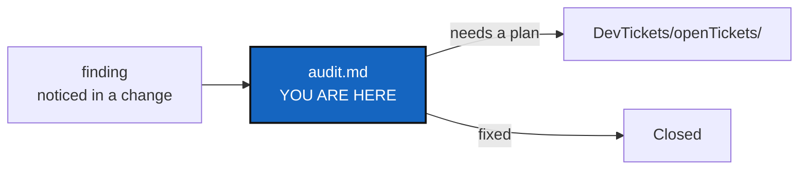

# Audit — findings and open risks in HydrologicalTwinAlphaSeries's spec tree

*Created: 2026-11-19*

## Abstract — read this first

**What this document is.** Findings that are not rules: places where the
code, the public docs and these specs disagree, and open risks, each with
where it is tracked. Clean-up of the code itself is tracked in the public
`docs/TODO.md`; this file does not repeat it.

**Why it exists.** A finding noticed in passing and left in a report is
lost. Here it waits for a ticket or a fix.

**What you will find.** One table of open findings, then the findings
closed, with the change that closed them.

**Who it is for.** The orchestrator, when it ranks tickets or quotes a
change.

**What you need to do with it.** Add a row when you find a disagreement you
do not fix in the same change; move it to *Closed* in the change that fixes
it.

---

## Open findings (2026-11-19, seeding of the HT-BETA spec tree)

| # | Finding | Where | Tracked by |
|---|---|---|---|
| 1 | CI writes the version: `bump-version.yml` bumps `III.alpha.NN` on every push to `main`, against the shared Versioning rule | `.github/workflows/bump-version.yml` | SemVerPixi |
| 2 | The user guide's version is hand-synced and has drifted: `\def\version{000.alpha.18}` against `000.alpha.40` | `docs/hydrological_twin/HTAS_user_guide.tex:8` | SemVerPixi |
| 3 | `docs/TODO.md` still holds an unresolved merge conflict (`<<<<<<< HEAD` … `>>>>>>> 388d82e`) | `docs/TODO.md:71-148` | none yet |
| 4 | The README describes `ht/persistence.py` (pickle mixin) and `accessors.py`; neither exists any more (`accessors.py` became `services/public/twin_io.py`) | `README.md`, *Repository Structure* and the conceptual diagram | none yet |
| 5 | An L3 module imports from L2: `services/private/raw_data_export.py:20` imports `ht.developer.api_types` (indented, to check it is under `TYPE_CHECKING`) | `services/private/raw_data_export.py` | none yet |
| 6 | The README names no agent: there is no *LLM assistance* section, which AgentConduct §3 expects when an agent contributes | `README.md` | owner's decision |
| 7 | No `check-spectree` task: the agreement of `AgenticManifest.md` with `.config/htas-dev-beta.cgs`, and of `digest.md` with its sources, is kept by hand | the Pixi tasks | none yet |
| 8 | There is no `pixi.toml`: Pixi is configured inside `pyproject.toml`, so `cgitsync version diagnose` reports HTAS `not versioned` | `pyproject.toml` `[tool.pixi.*]` | SemVerPixi |

## Closed

None yet.
