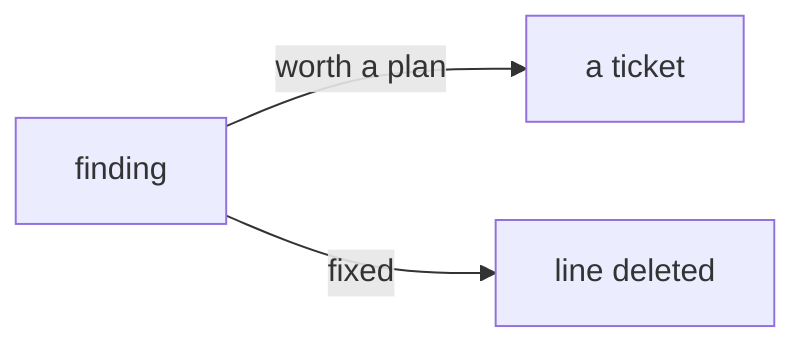

# Audit — GX4G's findings and open risks

*Created: 2026-10-27*

## Abstract — read this first

**What this document is.** What the audits found and left: where the project
departs from DevSpecs, the findings accepted with a reason, and the open
risks. It states no rule. A finding that is fixed is deleted from here, in
the change that fixes it: the ticket's record keeps its history.

**Who it is for.** The Orchestration role, when ranking tickets.

**What you need to do with it.** Close a finding in the change that fixes
it, by deleting its line.

---

## Departures from DevSpecs

- **Documentation is inside the repository.** DevSpecs prefers `docs/`
  as a separate repository; GX4G keeps `doc/` in the gx4g repository and
  names it `doc`, not `docs`. It is self-contained and builds alone.
- **No Getting Started / User Guide pair as DevSpecs names them.** The
  book has `c_getting_started` and the theory and architecture chapters;
  there is no user guide, because there is no CLI yet (EnvConnect E0).
- **No logging.** The kernel is pure and logs nothing; DevSpecs'
  *Logging* applies once the gate runs commands (E0–E3).

## Accepted findings

From BeforeCgitsyncMerge's audit of the kernel. Each is accepted with its
reason, and reopened if the reason stops holding.

- **F04, `ExecutionHash` comparison is not constant time.** A HASH(@) is a
  public proof: how long a comparison takes reveals nothing. The type's
  documentation says it is never to be compared against a secret. Reopen the
  day a hash is used as a capability or compared to a credential.
- **F06, a `ClientGraph` or `ServerGraph` is trusted.** Any type can claim to
  be a CLIENT or a SERVER, and `edge()` returning `None` is the only
  validation. They are in-process values chosen by the caller, so the trust
  boundary is where a request is parsed into `G`, which EnvConnect E2 and E3
  build. Reopen when a CLIENT can come from outside the process.

## Open risks

- **The anchor's moment is a claim.** `SystemClock` reads the wall clock, which
  can be set back or wrong, and nothing here checks moments against each other:
  entry 7 may carry an earlier moment than entry 6. The sequence is the order.
  `HASH(@)` covers both, so a wrong clock is recorded, not hidden. A trusted time
  source (an RFC 3161 token, a signed time) is a later decision, and the same
  question as ComplexGitSync's UniversalTime.
- **`FileStore` relies on `hard_link` being atomic and exclusive.** That holds on
  local file systems. A network file system that does not honour it could let
  two writers share a number; `verify_log` would then name the damage, but not
  prevent it. Windows cannot flush a directory, so a crash there may lose the last
  published name though not corrupt one.
- **`verify` and the sequence scan are linear.** `last_sequence` lists the log
  directory and `verify` walks the log from its start: fine for thousands of
  entries, not for millions. An index is a later change.
- **Nothing is ever pruned.** The log and the records only grow, by design. A
  retention policy would need a way to say "this entry was removed on purpose"
  that the chain can carry.
- **An orphan record is kept.** A crash between writing a record and publishing
  its entry leaves a record no entry names. It is harmless and not read, and
  nothing removes it.
- **A hostile writer on the same directory is out of scope.** Someone who can
  write the store can add entries that verify, because the log is hash-chained
  and not signed. `HASH(@)` shows what this store committed, not who committed it.
- **`G` does not check a proof against an expected content.** `verify` says the
  store committed a proof; it does not say which request it was. That is the
  caller's, with the replay of a recorded anchor.
- **`NAME`, `NODE` and `OP*` are not yet in `G`.** It carries its EDGE, its L0
  and its MEM until EnvConnect E2 types the rest.
- **`GitProvider` is read as the `Edge` interface.** The ticket's note on D2
  reads it so, and EnvConnect §7 plans `graph.rs` with `Edge`. Confirm before
  `Edge` is typed.
- **A real provider's bounds are a promise, not a test.** The trait
  documents bounded size and time, and the fake can only return `Timeout` and
  `TooLarge`. A real provider proves them against a mock server (EnvConnect E6).
- **Content write has no contract cases.** The owner built rights first (D4):
  the denied-write, no-retry-on-write and check-then-act-on-write cases of the
  plan wait for the milestone that builds writing.
- **GitLab sub-groups are refused** (`group/sub/repo`): one owner, one name.
- **A `Secret` is not wiped on drop**, which needs `unsafe` or a new
  dependency.
- **The surface test guards `lib.rs`, not the methods of an exported type.**
  A `pub fn` added to `G` passes it. `cargo public-api` would catch it
  and is not adopted.
- **Compile-fail snapshots follow the compiler's wording.** A new toolchain can
  reword a message and fail `ui_tests`. The fix is to read the diff and keep
  it only if the reason is unchanged (`tests/ui_tests.rs`).
- **The bump commands do not exist.** Versions are bumped by hand until
  EnvConnect E0, with `tests/version_tests.rs` as the only check.
- **No spec-tree check.** Nothing verifies this tree's links, manifest,
  digest citations or `*Fills in:*` lines (SpecTree §5).
- **No pair-rule gate.** Nothing refuses a ticket archived without its
  orchestrator's record (AgentConduct §4.2).
- **No hosted CI.**
- **The DEV Operating Space cannot be opened.** `examples/gx4g4dev.cgs`
  fails in ComplexGitSync up to 7.3.0 (NestedAgentMaster).
- **The documentation cites ComplexGitSync 6.10.0**; upstream is 7.3.0,
  which archived EnvConnect's ComplexGitSync half and moved host-API calls
  and register writes to gx4g (ProviderMigration). `\cgsversion`, the
  README, `GX4G.md` and tutorial 04 need checking against it.
- **The `main` branches of `.dev` and `.claude` carry other projects'
  leftovers** (a `cgitsync-dev.md`, a `settings.json` allowlist with
  ComplexGitSync paths), which a `gx4g` branch made from `main` inherits.
- **The `.omniscience` register is empty**, so the first registration into
  it is untested.
