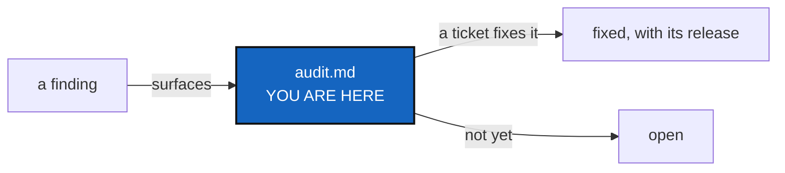

# Audit — findings on CaWaQS's build, versions and checks

*Created: 2026-05-14*

*Rewritten for CaWaQS: 2026-11-25 (BuildSemVerAgenticC §3.4)*

## Abstract — read this first

**What this document is.** A live log of audit findings: what was found
wrong or missing in CaWaQS's build, version numbers, install scripts and
checks, whether it is fixed, and what is still open. It states no rule; the
rules are in [AdditionalSpecs.md](AdditionalSpecs.md).

**Why it exists.** The seeded audit described ComplexGitSync's `.cgs`
format. CaWaQS has its own, and a finding must not be kept only in a ticket
that gets archived.

**What you will find.** Findings with a status (*fixed* with the release
that fixed it, or *open*), then the trials still pending.

**Who it is for.** The owner and the orchestrator, when they decide what a
release must fix.

**What you need to do with it.** Add a bullet as soon as a real finding
surfaces, and mark it fixed, with the release, when it is. Remove nothing
that is still open.

---

## Findings

- **`make version` called a missing `update_version.sh`.** *Fixed in 4.2.0*
  (BuildSemVerAgenticC, D3): it prints `cawaqs <SemVer> (branch, commit)`
  from `pixi.toml` and git, and `pixi run version` runs it.
- **`main_cawaqs.c` said `VERSION ID : 3.x`.** *Fixed in 4.2.0*: it says
  `see pixi.toml`.
- **The build number `4.01` was a float in C**, printed with 111 `%4.2f`,
  and a SemVer string would have been undefined behaviour there, since
  `LP_printf`/`LP_error` carry no `format` attribute. *Fixed in 4.2.0*: the
  print calls take `%s`, and `libprint` 1.25 accepts a string.
- **`.gitlab-ci.yml` builds with the destructive `make_Cawaqs.sh`** (it
  clones and deletes the libraries). *Open, fixed in 4.3.0* (D6): the CI
  moves to `make_Cawaqs_from_branches.sh -p cawaqs -b <branch>`.
- **The format check is commented out** in `.gitlab-ci.yml`
  (`check-format`, `clang-format -n -Werror`). *Open.*
- **No `-std` and no warning flag** is set in any `Makefile`, so a mismatch
  such as `%f` with a `char *` is never reported. *Open.*
- **Two regression cases only** (`HYDRO_COUPLED.COMM`, `HYDRO_REPSUR.COMM`
  from `gtest/testcases`) run in CI. *Open.*
- **`scripts/check_version.sh` maps six codes to `V_AQ`** (`rive`, `seb`,
  `tube`, `mb`, `hyd`, `ap`), because the tests are written `["$1" = …]`
  with no space after `[`. *Open, fixed in 4.3.0* (`scripts` 1.0.0).
- **Other libraries' copies of a `V_xx` lag** (for example `libwet`
  `V_LP=1.22`). Harmless: the build rewrites them in the `Makefile_tmp` it
  compiles. `pixi run check-version` lists them as information only.
- **`libts/src/param_ts.h` defines `VERSION_TS` twice**, with the same
  value. *Open, harmless*; `bump-build libts` moves both.
- **`cgitsync version diagnose` reports the 18 libraries as not versioned**
  and cawaqs as *task needed*, because it reads only the top-level
  `[tasks]`. *Open*, a generic request is filed in
  `DevTickets/dependency/CGS/`; nothing in CaWaQS waits for it.

## Trials pending

- **`-std=gnu99 -Wall` trial (D1): trial pending.** Adopt it only if every
  library and cawaqs build unchanged, with no source edit, and the
  `Makefile`s stay as simple. Otherwise leave the flags alone and record
  why here, with the warning count.
