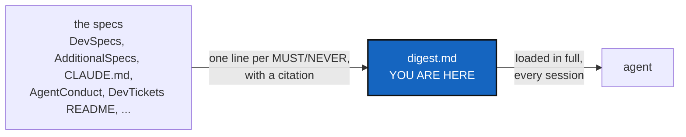

# Digest — every MUST/NEVER rule in the spec tree, one line each

*Created: 2026-09-25*

## Abstract — read this first

**What this document is.** The binding rules of this project's spec tree,
compressed to one line each, with a citation back to its source. No
rationale, no abstract, no example — that stays in the source, on purpose.
**`DevSpecs.md` comes first**, because it states the development philosophy
every other rule serves.

**Why it exists.** A rule that is correctly stated but two hops behind a
pointer, read once, competes badly against a freshly-repeated instruction
sitting one token away from where it needs to win. This file is what a
session loads in full, every time, so the rule is adjacent instead of
buried — `CLAUDE.md` points here.

**What you will find.** One bulleted list, grouped by topic, each line
ending in a source citation `` `File.md` §N ``. A spec that genuinely states
no rule is exempt in [AgenticManifest.md](AgenticManifest.md), with its
reason. Nothing can verify a line still says what its source currently says:
that is this file's own editorial upkeep.

**Who it is for.** Any agent, at the start of any session in this
repository, before drafting a commit, a push, a version bump, or a ticket.

**What you need to do with it.** Read it in full — it is short by design.
When a line and its source disagree, the source wins; fix this file to
match, in the same change that noticed the drift.

---

## What this project is

- The project is one self-contained deliverable: no plugins, adapters, or loosely coupled extension points unless the project's purpose is to be a framework. — `DevSpecs.md` §Monolithic Canonical API
- CaWaQS installs and builds with git, bash, gcc and make alone; ComplexGitSync is a development tool of the Operating Space only, and neither CaWaQS nor `scripts` depends on it. — `AdditionalSpecs.md` §The frontier
- CaWaQS never depends on HTAS; HTAS depends on CaWaQS. — `AdditionalSpecs.md` §The layers
- A library may include only the headers of libraries that build before it in `list_all.dat`, and cawaqs is never included by a library. — `AdditionalSpecs.md` §The layers
- A library's public prototype changes additively: the libraries are shared with programs outside CaWaQS. — `AdditionalSpecs.md` §The layers
- `scripts` writes no committed version, and a shared library holds no `pixi.toml` and no agentic file. — `AdditionalSpecs.md` §What never changes
- All development lands on `cawaqs_4X` (the root on `4X`); no `main` of a library or of `scripts` moves for a ticket. — `AdditionalSpecs.md` §What never changes

## The two levels

- Every agentic topic has one shared pattern and at most one local fill-in; a fill-in opens with a `*Fills in:*` line naming its pattern and states only the project's choices, names and exceptions — it never restates the pattern. — `SpecTree.md` §2
- A rule goes in the digest, and a mount or spec file in the manifest, in the same change that adds it. — `SpecTree.md` §3–§5
- An open ticket is cited by name, never by path, because finishing it renames it. — `TICKETLIFECYCLE.md` §2.2
- `.agent/` is a plain directory and never itself a mounted repository. — `AgenticManifest.md` §Mounts

## Versions

- `pixi.toml` `[workspace] version` is the one SemVer of CaWaQS, copied into `param_caw.h`, `src/Makefile`, `CITATION.cff` and the README; never hand-edit a copy, run `pixi run bump-version`. — `AdditionalSpecs.md` §The version rules
- `NVERSION_CAW` is a string printed with `%s`, never `%f` or `%4.2f`; `V_CAW` is written unquoted. — `AdditionalSpecs.md` §The version rules
- A library's `VERSION_xx` is its build `MAJOR.XX`, printed with `%4.2f`, kept in its own `Makefile` `V_xx` and `param_*.h`; the worker bumps it with `pixi run bump-build <lib>`. — `AdditionalSpecs.md` §The version rules
- `LP_log_file_header` and `LP_file_header` accept a `double` or a string under one name; never change their old signature. — `AdditionalSpecs.md` §The version rules
- Regular SemVer applies by default; an exception exists only when the owner states it for a named release, and it covers only that release. — `Versioning.md` (.dev) §The scheme
- CI never writes a version: a bump is a release decision made by a reader, through `pixi run bump-version`. — `.agent/.distant/dev-sync/Versioning.md`
- `bump-version` is the orchestrator's; the worker never runs it. — `AgentConduct.md` §4.1

## Attribution and commits

- An agent is never credited on a commit, merge, or pull request — no co-authorship trailer, no "generated with" line, in any repository of the tree. — `AgentConduct.md` §3
- A self-history/accounting record of an agent's work must never reach a public repository, and nothing in it may be copied into one. — `AgentConduct.md` §3
- In private repositories specs, tickets and records keep the real vendor and model; in a public repository an example that needs one uses the placeholders `vendor-name` and `model-name`. — `cawaqs-dev.md` §Whose data this is, and attribution
- No document, commit message or ticket names a person; a commit that takes a change from another branch cites its hash only. — `cawaqs-dev.md` §Whose data this is, and attribution
- Never push to a remote without being asked; deliver the commit message and let the owner decide whether to commit. — `AgentConduct.md` §1
- A commit message starts with `<project-name>-<version>` (this project writes `cawaqs-<SemVer>`), is one message reused for every repository the change touched, plain English, three lines at most. — `AgentConduct.md` §2

## Before a task is finished

- `pixi run build` must succeed with no new warning, and the regression cases must run, before any task is considered closed. — `cawaqs-dev.md` §Before committing, step 1
- Run `pixi run bump-build <lib>` for each library whose `src/` changed. — `cawaqs-dev.md` §Before committing, step 2
- `cgitsync status`, run from the tree's own root, must show `errors=0` before a task is finished. — `cawaqs-dev.md` §Before committing, step 3
- `pixi run check-version` must pass before the commit message is delivered. — `cawaqs-dev.md` §Before committing, step 4
- A new option of an install script is documented in the README install tables, the user's front page. — `cawaqs-dev.md` §Before committing, step 7

## Implementing a ticket

- Implementing a ticket takes a worker agent and an independent orchestrator agent; the owner saying `implement <ticket>` is the explicit request to launch the orchestrator with the Agent tool, in the foreground, and needs no further permission. — `CLAUDE.md` §When the owner says implement
- `implement "CORR: @agent-dev"` resolves, in the current Operating Space, every file whose first line is `CORR:` or `CORRection:` followed by `@agent-dev` (or `@dev-agent`): each as written, header and note removed so the file is valid again, each listed in the report. — `CLAUDE.md` §When the owner says `implement "CORR: @agent-dev"`
- A ticket's Decisions for the owner are asked before the first edit; a recommendation is never taken as the answer. — `AgentConduct.md` §4.1
- The worker never runs `bump-version`, writes a self-history record, or scores its own work; the orchestrator does, and re-quotes after every fix. — `AgentConduct.md` §4.1
- A planning ticket's filename branch prefix and its own `*Branch:*` line must agree. — `TICKETLIFECYCLE.md` §2.3
- A short ticket is stamped and moved to `archive/.closedUserTicket/` in the same change that satisfies it, and never edited afterwards. — `TICKETLIFECYCLE.md` §6
- Archiving a planning ticket writes two copies in one change: the history ticket in `archive/`, whose only allowed edit is a corrected link, and an immutable deep-archived copy in `archive/.deepArchive/`, never edited at all. — `TICKETLIFECYCLE.md` §4.1
- One concern per commit across agents: a `DELETE`/`MOVE`/`CHANGE` by one role is never bundled with another role's change. — `.agent/.distant/dev-sync/AGENT.md` §Handoff rules
- A request to a development tool (ComplexGitSync) is written as a generic feature of that tool, never as something CaWaQS waits for. — `DevTickets/README.md` §1

## Documents

- Every Markdown document opens with an abstract carrying a mermaid graph. — `DOCSTYLE.md` §1
- The one exception is the project's root `README.md`, the user's front page. — `CLAUDE.md` §Document conventions
- There is one authoritative file per purpose. — `DOCSTYLE.md` §7
- Documents and finishing reports are plain English. — `DOCSTYLE.md` §5
- Documents never carry dated "recent improvements" blocks that rot. — `DOCSTYLE.md` §6
