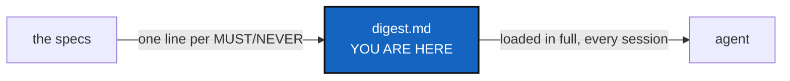

# Digest — every MUST/NEVER rule in GX4G's spec tree, one line each

*Created: 2026-10-27*

## Abstract — read this first

**What this document is.** The binding rules of GX4G's spec tree, one line
each, with a citation back to the source. No rationale, no example.

**Why it exists.** A rule two hops behind a pointer is forgotten
([SpecTree.md](../../.distant/dev-sync/SpecTree.md) §3). A session loads
this file in full, so every rule sits in view.

**Who it is for.** Any agent, at the start of any session, before a
commit, a version bump or a ticket.

**What you need to do with it.** Read it in full. When a line and its
source disagree, the source wins; fix this file in the same change.

---

## What GX4G is

- GX4G is one self-contained deliverable: no plugins or loosely coupled extension points. — `DevSpecs.md` §Monolithic Canonical API
- Every public item is documented, and the public surface is what `lib.rs` re-exports. — `DevSpecs.md` §Monolithic Canonical API, `AdditionalSpecs.md` §6
- Once `pixi run gx4g` exists, it mirrors the Rust API one-to-one, and every entry point shares one implementation. — `DevSpecs.md` §Monolithic Canonical API
- A CLI follows one grammar: a subcommand is a plain word, a `--name` only changes how an action runs, `-x` is only a short form, a hyphen never glues a command to its subcommand, and a command has subcommands or acts itself, never both. — `DevSpecs.md` §CLI Grammar
- Validate at every public boundary; errors are typed and documented; partial success is never acceptable. — `DevSpecs.md` §Error Handling, `AdditionalSpecs.md` §6
- The Rust toolchain comes from Pixi, never `rustup` or a system install, in docs and in CI. — `AdditionalSpecs.md` §6
- `lib.rs` keeps `#![forbid(unsafe_code)]` and `#![deny(missing_docs)]`; `src/` holds no `unwrap` and no `expect`; the lints live in `Cargo.toml`. — `AdditionalSpecs.md` §6
- A compile-fail snapshot is read before it is accepted, and must fail for the reason its file says; a new property, surface or log test is shown once to fail against a deliberate bug. — `AdditionalSpecs.md` §6
- A test that writes uses a directory of its own under the system's temporary directory, removed when the test ends. — `AdditionalSpecs.md` §6
- A new dependency, dev-dependency or feature needs the owner's word; `cargo deny` and `cargo audit` pass before a release. — `AdditionalSpecs.md` §6
- No test reaches the network. — `DevSpecs.md` §Testing

## The boundary with ComplexGitSync

- GX4G never imports or patches ComplexGitSync; it calls `pixi run cgitsync` like any user, and gives it no access-control code. — `AdditionalSpecs.md` §1
- GX4G never computes a Merkle root or a `node` hash: `H_project`, its four roots and their proofs are provided by cgitsync and only relayed. — `AdditionalSpecs.md` §1
- X never crosses the frontier: GX4G never handles `X.root`, and the `.omniscience` record holds no X. — `AdditionalSpecs.md` §1
- Calls to a Git host's API and writes to the `.omniscience` register are GX4G's; ComplexGitSync adds neither. — `AdditionalSpecs.md` §1

## The kernel

- The order is fixed: `.listen → build_context → @CGS → L0 → MEM → FS → HASH(@) → .emit`. Each phase takes only the type the one before returned, none is skipped, reordered or run twice, and the first failure stops every later phase. — `AdditionalSpecs.md` §2
- Only `G::execute` makes an `ExecutionHash`: the phase functions are `pub(crate)`, every module is private, every type that passes between the phases is crate-private, and `ExecutionHash` and `GatewayOutput` have private fields. — `AdditionalSpecs.md` §2
- `HASH(@)` is derived only from a record that was committed, read back and checked, and `GatewayOutput` holds it and nothing else. — `AdditionalSpecs.md` §2, §2.2
- `src/lib.rs` is the only place anything is exported; the public-surface test fails when the list changes or when a type that passes between the phases appears in it. — `AdditionalSpecs.md` §2
- `hash.rs` is the only module that hashes; every preimage starts with its domain string and is length-delimited; a type implementing `CanonicalBytes` names itself with `TYPE_LABEL`, which has no default. — `AdditionalSpecs.md` §2, §2.2
- A change to what is hashed is a new version of its domain, with an independently recomputed golden hash (`tests/spec/spec.py`) and a migration note; a released hash never changes meaning. — `AdditionalSpecs.md` §2
- No ambient clock, randomness, environment or iteration order enters a hash; an anchor enters only as a supplied value, and `SystemClock` is the only reader of the wall clock. — `AdditionalSpecs.md` §2
- L0 stamps the execution before MEM inks it, from a sealed `AnchorSource`; the anchor is the moment and the log's sequence number, and the sequence, not the moment, orders executions. — `AdditionalSpecs.md` §2.2
- MEM computes and writes nothing, FS anchors and emits nothing, L0 owns no STATE and persists nothing, and the Gateway owns communication only. — `AdditionalSpecs.md` §2
- A record is committed when its entry is published; publishing is atomic and exclusive, so two writers never share a sequence number, and a record that never committed leaves no anchor. — `AdditionalSpecs.md` §2.2
- FS reads back what it wrote and refuses unless it is what it wrote; a store that claims a write it did not make gives no proof. — `AdditionalSpecs.md` §2.2
- The log is append-only: nothing rewrites, removes or repairs an entry or a record, and an existing record is never replaced, so damage is found by `verify_log`, by position. — `AdditionalSpecs.md` §2.2
- `Store` is sealed, with two backends in this crate; only `FileStore` touches the file system, with `std` and no dependency, and the crate opens no socket. — `AdditionalSpecs.md` §2, §2.2
- A record is bounded (64 MiB) when it is built and when it is read, and decoding checks a length against what remains before copying anything. — `AdditionalSpecs.md` §2.2
- No `StoreError` or `Corruption` carries a path or a byte of content, and `MemoryStore`'s `Debug` shows counts only. — `AdditionalSpecs.md` §2.2

## The host side

- `G` is the one public API over the Graph: a `GitRepo`, a provider, the Gateway and every phase of the proof are reached only through it. — `AdditionalSpecs.md` §2.1
- A `G` that only makes proofs uses `Offline`, an EDGE that reaches no host and refuses every repository with `GitError::NoHost`. — `AdditionalSpecs.md` §2.1
- `GitProvider` is sealed: only this crate adds a host, and a real provider passes the contract suite against a local mock server before it is added. — `AdditionalSpecs.md` §2.1
- No network code is added to this crate before EnvConnect E6, and no test ever calls a real host. — `AdditionalSpecs.md` §2.1
- Only host rights are built; reading and writing content are added by their own milestone, behind their own ring. — `AdditionalSpecs.md` §2.1
- A host can only narrow a ring: access is the smaller of the ring's ceiling and the host's answer, and a host that cannot be asked gives no access. — `AdditionalSpecs.md` §2.1
- A host's answer is information, never a permit: it is asked every time, and nothing caches it. — `AdditionalSpecs.md` §2.1
- A repository identifier is parsed, never trusted: an unknown host, a second `/`, a character outside ASCII letters, digits, `-`, `_` and `.`, a part over 100 bytes, `.`, `..` and a `.git` suffix in any case are refused, and the host's address comes from the provider's type. — `AdditionalSpecs.md` §2.1
- A rate limit is never a refusal, and `G` retries neither. — `AdditionalSpecs.md` §2.1
- No error, `Debug` or `Display` output carries a token or the input; a token is a `Secret`, which is never `Clone` and never a field of a `GitRepo`. — `AdditionalSpecs.md` §2.1

## The gate

- Only Σ = 0 may change a tree; each ring makes exactly its own cgitsync call and no other. — `AdditionalSpecs.md` §3
- The fourth coordinate of `*OP.poe` is the constant `0` and cannot be set. — `AdditionalSpecs.md` §3
- The gate registers exactly `(time, loc, H_project)`; `time` and `loc` change no hash. — `AdditionalSpecs.md` §3
- The id is parsed with its one pattern, never split on one character; build metadata (`+…`) is refused. — `AdditionalSpecs.md` §3
- No credential is ever stored, printed, logged or recorded. — `AdditionalSpecs.md` §3

## The two levels and the specs

- Every agentic topic has one shared pattern and at most one local fill-in, which opens with a `*Fills in:*` line and never restates the pattern. — `SpecTree.md` §2
- A rule goes in this digest, and a mount or spec file in `AgenticManifest.md`, in the same change that adds it. — `SpecTree.md` §3–§4
- `install.cgs` mounts no private repository; the developer specs add the agentic mounts. — `DevSpecs.md` §Two installs
- `examples/` holds one `.cgs` only, `gx4g4dev.cgs`; the `.agent/` mounts are the entries it declares, and `AgenticManifest.md` changes with it. — `AdditionalSpecs.md` §4
- An open ticket is cited by name, never by path. — `TICKETLIFECYCLE.md` §2.2

## Attribution and commits

- An agent is never credited on a commit, merge or pull request: no co-author trailer, no "generated with" line, in any repository. — `AgentConduct.md` §3
- The agent is named publicly only in the README's *LLM assistance* section; tickets and records in `.agent/.local/` keep the real vendor and model. — `gx4g-dev.md` §Attribution
- A record of an agent's work never reaches a public repository. — `AgentConduct.md` §3
- A commit message starts with `gx4g-<version>`, is one message for every repository touched, plain English, three lines at most. — `AgentConduct.md` §2
- Never commit or push without being asked; deliver the message and stop. — `AgentConduct.md` §1

## Before a task is finished

- `cargo fmt --check`, `cargo clippy … -D warnings` (with and without `--all-features`), the full test suite, `cargo deny` and `cargo audit` pass. — `gx4g-dev.md` §Before committing, step 1
- Every change under `src/` bumps `BUILD` in `src/version.rs`. — `gx4g-dev.md` §Before committing, step 2
- Every build bump is followed by a release bump, `patch` at least, in the same change; a fix to an uncommitted version still gets its own patch. — `Versioning.md` (dev-sync) §3, §5
- CI never writes a version. — `Versioning.md` (dev-sync) §2
- A release bump touches every target (`Cargo.toml`, `Cargo.lock`, README title, `\gxversion`) or none. — `Versioning.md` (.dev) §2–§3
- The build counter never appears in the README, `GX4G.md` or `doc/`. — `Versioning.md` (.dev) §2
- Every PDF in `doc/` is rebuilt after a version bump and after any docs change. — `gx4g-dev.md` §Before committing, step 5
- `AdditionalSpecs.md` is updated in the change that moves a responsibility. — `gx4g-dev.md` §Before committing, step 6

## Implementing a ticket

- `implement <ticket>` is the explicit request to launch the orchestrator with the Agent tool, in the foreground; it needs no further permission. — `CLAUDE.md` §When the owner says implement
- Every open decision of a ticket is asked before the first edit; a recommendation is never the answer. — `AgentConduct.md` §4.1
- The worker never bumps the release version, writes the orchestrator's record or scores its own work. — `AgentConduct.md` §4.1
- The orchestrator's record is appended to the ticket before it is archived. — `gx4g-dev.md` §The pair rule
- A ticket's filename branch prefix and its `*Branch:*` line agree. — `TICKETLIFECYCLE.md` §2.3
- Archiving writes the history ticket in `archive/` and an immutable copy in `archive/.deepArchive/`, in one change. — `TICKETLIFECYCLE.md` §4.1
- A short ticket is stamped and moved to `archive/.closedUserTicket/` in the change that satisfies it. — `TICKETLIFECYCLE.md` §6
- One concern per commit across roles. — `AGENT.md` (dev-sync) §Handoff rules

## Documents

- Every Markdown document opens with an abstract carrying a mermaid graph; the root `README.md` is the one exception. — `DOCSTYLE.md` §1–§2, `CLAUDE.md` §Document conventions
- One authoritative file per purpose. — `DOCSTYLE.md` §7
- Plain English, short sentences. — `DOCSTYLE.md` §5
- No dated "recent improvements" blocks. — `DOCSTYLE.md` §6
- A statement of design not yet built is marked `\planned` in `doc/` and "designed" in the README. — `AdditionalSpecs.md` §7
- The Rust guide explains and states no rule; the diagrams that show the threat model stay in the private `.dev`, and a change to what a diagram shows changes both forms. — `AdditionalSpecs.md` §7
