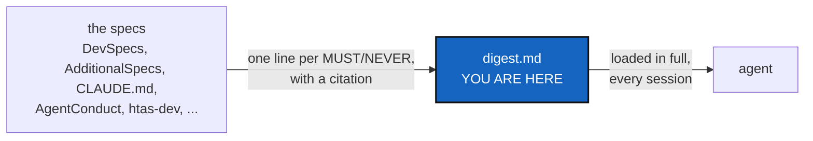

# Digest — every MUST/NEVER rule in the spec tree, one line each

*Created: 2026-11-19*

## Abstract — read this first

**What this document is.** The binding rules of HydrologicalTwinAlphaSeries's
spec tree, compressed to one line each, with a citation back to its source.
No rationale and no example: those stay in the source.

**Why it exists.** A rule correctly stated but two hops behind a pointer,
read once, competes badly against an instruction sitting next to where it
must win. This file is what a session loads in full, every time
(`CLAUDE.md`).

**What you will find.** One bulleted list, grouped by topic, each line
ending in a source citation. HTAS has no `check-spectree` task yet
(`audit.md` #7), so keeping every citation true is this file's own
editorial upkeep.

**Who it is for.** Any agent, at the start of any session in this
repository, before drafting a commit, a version bump or a ticket.

**What you need to do with it.** Read it in full. When a line and its
source disagree, the source wins; fix this file in the same change.

---

## What this package is

- The project is one self-contained deliverable: no plugins, adapters or loosely coupled extension points. — `DevSpecs.md` §Monolithic Canonical API
- Domain concepts are classes that own their validation and lifecycle; no free-standing function mutates shared state. — `DevSpecs.md` §Object-Oriented Design
- Every exported symbol appears in its module's `__all__` and is documented. — `DevSpecs.md` §Object-Oriented Design
- Every public operation acts on a `Compartment`, never on a mesh, an observation or an extraction point directly. — `AdditionalSpecs.md` §1
- Imports point strictly downward, L1 `ht/client` → L2 `ht/developer` → L3 `services` → `domain` → `config`/`tools`; a lower layer never imports a higher one, except for an annotation under `TYPE_CHECKING`. — `AdditionalSpecs.md` §3
- `cli/` (L0) only collects arguments and prints: each command calls one `HydrologicalTwinClient` method, no command lacks its method, no client operation lacks its command, `htas-dev` commands are generated from `ht.developer.KINDS` and every kind has one, and a missing capability is added below `cli/`, never in it; `cli.COMMANDS` is the one registry. — `AdditionalSpecs.md` §2–§3
- L1 is a pure orchestrator: it computes nothing itself. — `AdditionalSpecs.md` §2
- No module under `src/` imports `qgis`, `qgis.PyQt`, `PyQt5` or `PyQt`; `tests/unit/test_qgis_free.py` enforces it. — `AdditionalSpecs.md` §5
- No module passes 2000 lines; one that would is split, with the owner's agreement, in the change that would make it pass. — `AdditionalSpecs.md` §6
- Python work goes through `pixi`, never bare `pip`, `python -m pip` or `venv`, in code, docs or CI. — `DevSpecs.md` §Python Environment and Package Management

## The two levels

- Every agentic topic has one shared pattern and at most one local fill-in; a fill-in opens with a `*Fills in:*` line and states only the project's choices, never the pattern again. — `SpecTree.md` §2
- A rule goes in this digest, and a mount or spec file in `AgenticManifest.md`, in the same change that adds it. — `SpecTree.md` §3–§5
- Never write in `.agent/.distant/` or in the `ComplexGitSync/` checkout from this tree: both are read-only here. — `AgenticManifest.md` §Mounts
- An open ticket is cited by name, never by path, because finishing it renames it. — `TICKETLIFECYCLE.md` §2.2

## Attribution and commits

- An agent is never credited on a commit, merge or pull request: no co-authorship trailer, no "generated with" line, in any repository of the tree. — `AgentConduct.md` §3
- In the public front (`HydrologicalTwinAlphaSeries`, `hydrological_twin`), an example that needs an agent's vendor or model writes `vendor-name` and `model-name`. — `htas-dev.md` §Attribution
- In private repositories, specs, tickets and records keep the real vendor and model. — `htas-dev.md` §Attribution
- A self-history record never reaches a public repository, and nothing in it is copied into one. — `AgentConduct.md` §3
- Never push to a remote without being asked; deliver the commit message and let the owner decide whether to commit. — `AgentConduct.md` §1
- A commit message starts with `HydrologicalTwinAlphaSeries-<version>`, is one message reused in every repository the change touched, plain English, three lines at most. — `AgentConduct.md` §2, `htas-dev.md` step 8

## Before a task is finished

- `pixi run lint` and `pixi run test` must both pass, with the QGIS-free guard and the drift tests; lint shows no new error. — `htas-dev.md` step 1
- There is no CI: the local gate, run before every commit and push, replaces it. — `htas-dev.md` §Commands
- Every change updates, in the same change, each document the doc-impact map names for it. — `htas-dev.md` step 7
- The user guide names every `htas` command and option and every `htas-dev` verb and kind; `test_user_guide_cli.py` fails otherwise. — `htas-dev.md` §The doc-impact map
- `src/` is the reference: a document never names a path, module, class, method, keyword, verb, `kind`, task or command that `src/` lacks. — `htas-dev.md` step 7
- `cgitsync status`, run from the tree's own root, must show `errors=0`. — `htas-dev.md` step 3
- CI never writes a version; a bump is a release decision made by the orchestrator or the owner. — `Versioning.md` (dev-sync)
- HTAS is laid out as ComplexGitSync is: `pixi.toml` (Pixi, tasks, the version `cgitsync` reads) beside `pyproject.toml` (the build, the console script); no `[tool.pixi.*]` in `pyproject.toml`. — `Versioning.md` (.dev)
- The version is SemVer, read from `pixi.toml`; every copy of it is a `bump-version` target, written all or none; never hand-edit a version field. — `Versioning.md` (.dev) §Where the version lives
- A literal HTAS version outside the `bump-version` targets (`TARGETS` in `bump_version.py`) fails `test_version_mirrors`; `bump-version` then rebuilds the user guide, and `pixi run check-build-version` fails a commit that moves `__build__` without the version. — `Versioning.md` (.dev)
- Every change under `src/` runs `pixi run bump-build` (the worker), then `cgitsync version bump <level>` (it runs `pixi run bump-version`), `patch` at least, run by the orchestrator under `implement`. — `Versioning.md` (.dev) §Who bumps what
- When a responsibility moves between layers, `AdditionalSpecs.md` §2 is updated in the same change. — `htas-dev.md` step 6

## Implementing a ticket

- `implement <ticket>` is the explicit request to launch the orchestrator with the Agent tool, in the foreground, and needs no further permission. — `CLAUDE.md` §When the owner says implement
- A ticket's Decisions for the owner are asked with `AskUserQuestion` before the first edit; a recommendation is never the answer. — `AgentConduct.md` §4.1
- The worker never runs `cgitsync version bump` or `bump-version`, writes a self-history record or scores its own work; the orchestrator does, and re-quotes after every fix. — `AgentConduct.md` §4.1
- The orchestrator's quote carries a *Docs touched* line; a document the doc-impact map names and the diff leaves stale is a blocking defect. — `AGENT.md` (.localSpec) §The orchestrator's quote
- A planning ticket's filename prefix (`HT-BETA_`) and its `*Branch:*` line must agree. — `TICKETLIFECYCLE.md` §2.3
- A short ticket is stamped and moved to `archive/.closedUserTicket/` in the change that satisfies it, and never edited afterwards. — `TICKETLIFECYCLE.md` §6
- Archiving a planning ticket writes the history ticket in `archive/` and an immutable copy in `archive/.deepArchive/`, in one change. — `TICKETLIFECYCLE.md` §4.1
- One concern per commit across agents: a `DELETE`/`MOVE`/`CHANGE` by one role is never bundled with another role's change. — `.agent/.distant/dev-sync/AGENT.md` §Handoff rules

## Documents

- Every Markdown document opens with an abstract carrying a mermaid graph; the one exception is the root `README.md`, the user's front page. — `DOCSTYLE.md` §1, `CLAUDE.md` §Document conventions
- The root `README.md` is user-facing only, at most 250 lines, on ComplexGitSync's model, with no method or command table. — `htas-dev.md` step 7
- A White Book chapter that describes the HydrologicalTwin target opens with `\htastarget`; only there may it use the target's vocabulary. — `htas-dev.md` §The doc-impact map
- There is one authoritative file per purpose. — `DOCSTYLE.md` §7
- Documents and finishing reports are plain English. — `DOCSTYLE.md` §5
- Documents never carry dated "recent improvements" blocks that rot. — `DOCSTYLE.md` §6
